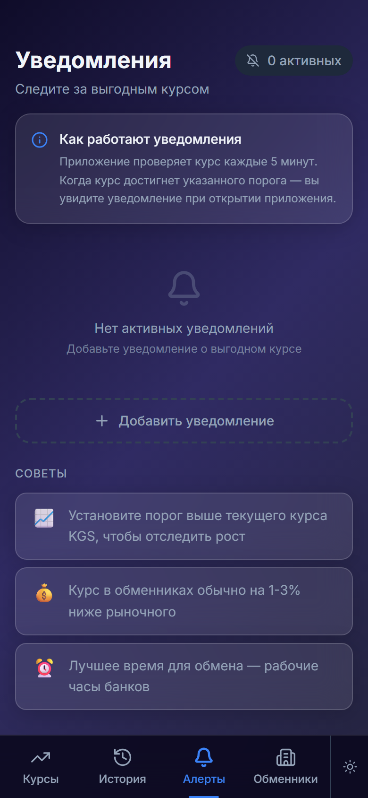
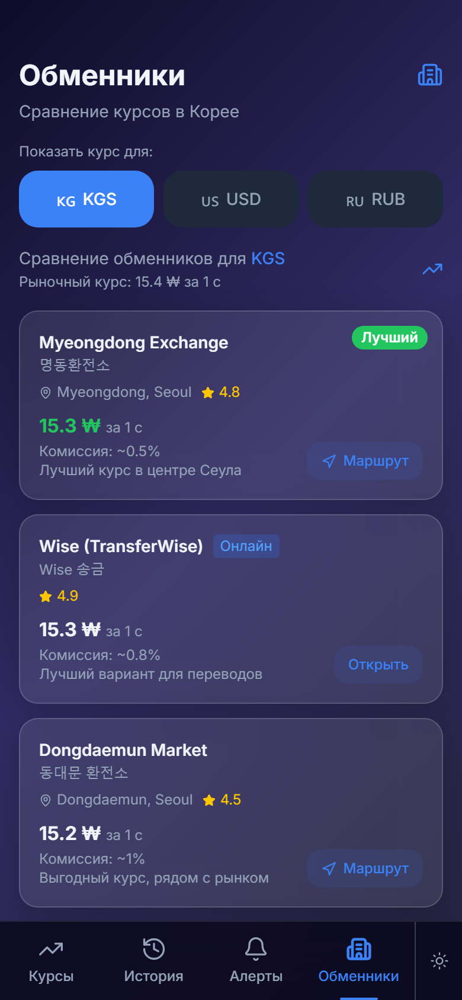

# Currency Radar

KRW exchange rates for people from Central Asia working and studying in Korea: Korean won against the Kyrgyz som, US dollar and Russian ruble, rate alerts and where to exchange.

Mobile-first React app, installable as a PWA and packaged as an Android app with Capacitor.

| Rates | History | Alerts | Exchangers |
|---|---|---|---|
|  |  |  |  |

## Features
- Live KRW rates against KGS, USD and RUB from [open.er-api.com](https://open.er-api.com), with offline fallback values
- Rate history chart with 7 / 30 / 90-day ranges and min / average / max
- Rate alerts saved on the device
- Exchange comparison with links to Wise and directions in Google Maps / Naver Map
- Dark and light theme

> The free API returns only current rates, so the history chart currently shows simulated data around the live rate. Switching to a history-capable API is the next step.

## Stack
React 19 · Vite · Tailwind CSS · Recharts · vite-plugin-pwa · Capacitor (Android)

## Run
```bash
npm install
npm run dev                         # http://localhost:5173
npm run build && npx cap sync android   # Android project in ./android
```
